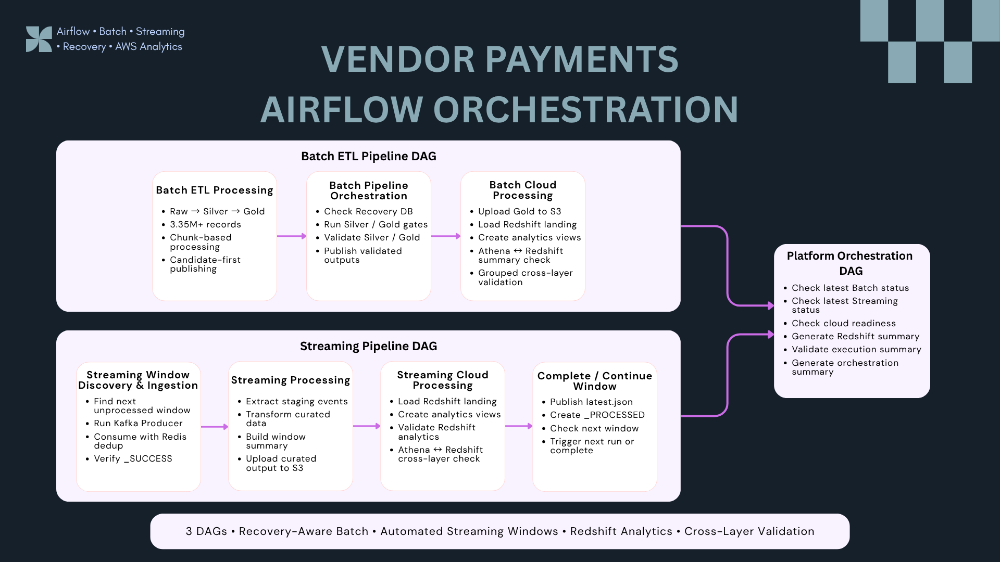
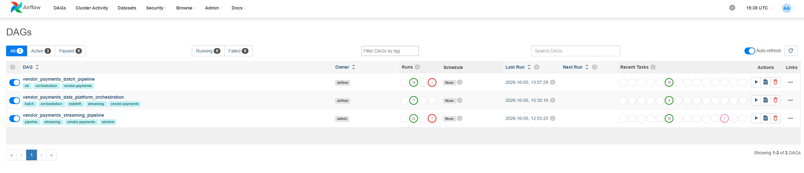
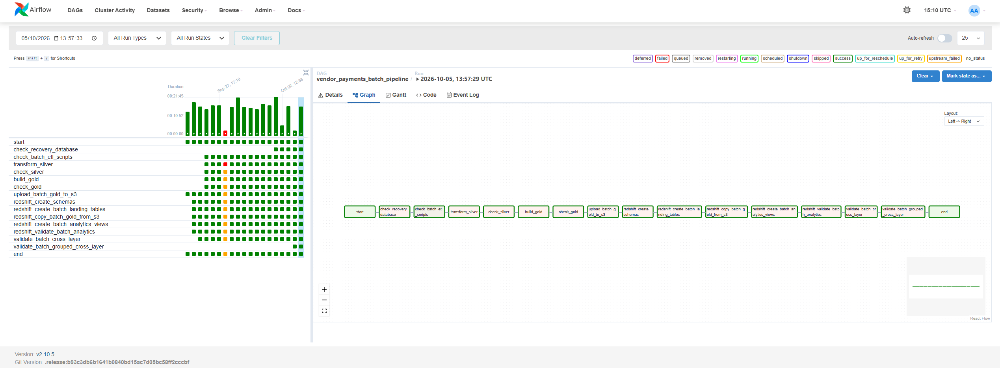
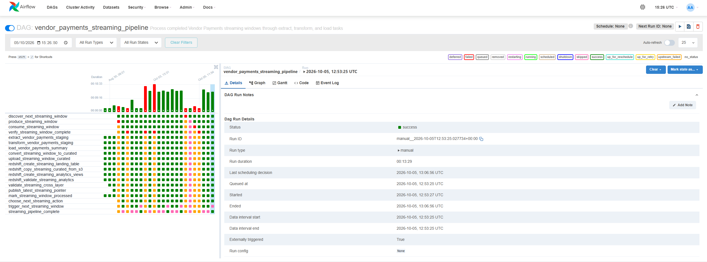
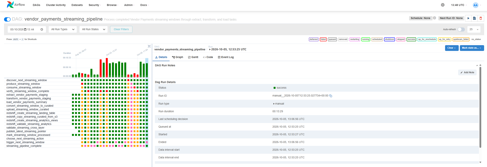
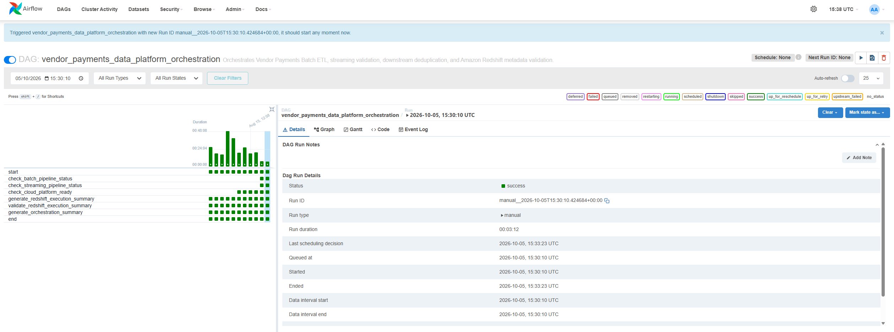
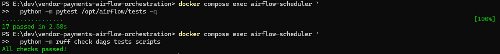
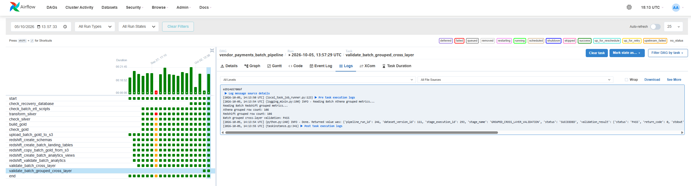
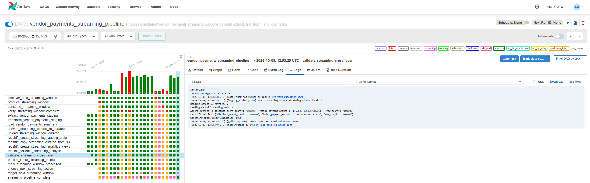
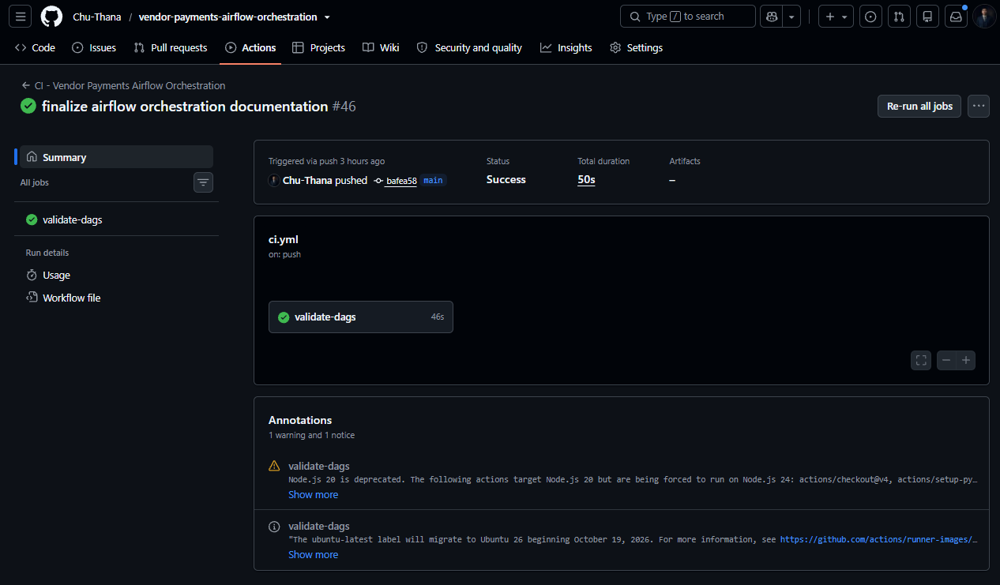

# 🛠 Vendor Payments Airflow Orchestration


Apache Airflow orchestration layer for the Vendor Payments Data Platform.

The final architecture separates **Batch**, **Streaming**, and **Platform-level orchestration** into three focused DAGs.

- The **Batch DAG** coordinates recovery-aware ETL, validation gates, Amazon S3 publishing, Amazon Redshift processing, and Athena ↔ Redshift reconciliation.
- The **Streaming DAG** automatically processes bounded windows through Kafka producer and consumer execution, downstream transformation, cloud processing, validation, completion markers, and next-window triggering.
- The **Platform Orchestration DAG** verifies the latest Batch and Streaming pipeline states before performing platform-readiness checks and final execution reporting.

---

## 📌 Project Summary

The repository contains three active orchestration lifecycles:

```text
vendor_payments_batch_pipeline
vendor_payments_streaming_pipeline
vendor_payments_data_platform_orchestration
```

This separation allows Batch and Streaming workloads to operate with different processing lifecycles while preserving a shared platform-level coordination layer.

Airflow is responsible for:

- Coordinating recovery-aware Batch execution
- Running Silver and Gold validation gates
- Publishing validated Batch Gold datasets to Amazon S3
- Loading Batch data into Amazon Redshift
- Creating and validating Batch analytics views
- Running Athena ↔ Redshift summary reconciliation
- Running grouped Batch cross-layer validation
- Discovering the next unprocessed Streaming window
- Running the Kafka producer for that window
- Running the Kafka consumer with Redis deduplication
- Verifying the Streaming `_SUCCESS` completion marker
- Transforming and publishing curated Streaming outputs
- Loading Streaming data into Redshift
- Validating Streaming analytics and cross-layer metrics
- Publishing `latest.json`
- Creating `_PROCESSED`
- Triggering the next Streaming window automatically
- Checking latest Batch and Streaming DAG run states
- Checking cloud-platform readiness
- Generating and validating Redshift execution metadata
- Generating a machine-readable platform orchestration summary
- Providing execution observability through the Airflow UI
- Enforcing automated tests, Ruff linting, and GitHub Actions CI

The core design principle is:

```text
Batch and Streaming own their processing logic.

Airflow owns execution order,
validation gates,
lifecycle control,
and platform-level coordination.
```

---

## 🧭 Architecture



```text
Batch ETL Pipeline DAG ───────────────┐
                                      │
Streaming Pipeline DAG ───────────────┼──→ Platform Orchestration DAG
                                      │
                                      └──→ Pipeline state / readiness checks
```

### Batch Lifecycle

```text
Raw
→ Silver
→ Silver Validation
→ Gold
→ Gold Validation
→ S3
→ Redshift
→ Athena ↔ Redshift Validation
→ Grouped Cross-Layer Validation
```

### Streaming Lifecycle

```text
Next Unprocessed Window
→ Kafka Producer
→ Kafka
→ Kafka Consumer
→ Redis Deduplication
→ _SUCCESS
→ Curated Processing
→ S3
→ Redshift
→ Athena ↔ Redshift Validation
→ latest.json
→ _PROCESSED
→ Trigger Next Window
```

### Platform Coordination

```text
Latest Batch DAG State ────────┐
                               ├──→ Platform Orchestration DAG
Latest Streaming DAG State ────┘
                                  ↓
                           Cloud Readiness
                                  ↓
                         Redshift Summary
                                  ↓
                      Execution Validation
                                  ↓
                     Orchestration Summary
```

The Platform DAG uses Airflow run metadata for coordination rather than passing Batch or Streaming datasets directly between DAGs.

---

## 📊 Current DAG Metrics

| DAG | Tasks | Latest Verified Result |
|---|---:|---|
| `vendor_payments_batch_pipeline` | 16 | Success |
| `vendor_payments_streaming_pipeline` | 19 | Success |
| `vendor_payments_data_platform_orchestration` | 8 | Success |
| **Total across 3 DAGs** | **43** | **Validated** |

Additional validation:

| Metric | Result |
|---|---|
| Automated tests | 17 passed |
| Ruff linting | PASS |
| Batch Athena ↔ Redshift validation | PASS |
| Batch grouped cross-layer validation | PASS |
| Streaming Athena ↔ Redshift validation | PASS |
| Platform Orchestration DAG | Success |
| GitHub Actions CI | Success |

---

## ⚙️ DAG Overview



The repository contains three active DAGs:

```text
vendor_payments_batch_pipeline
vendor_payments_streaming_pipeline
vendor_payments_data_platform_orchestration
```

The current portfolio environment uses:

```text
schedule=None
```

Runs are triggered manually for reproducible validation, while the Streaming DAG can trigger its next bounded-window run automatically.

---

# 🟦 Batch ETL Pipeline DAG

DAG ID:

```text
vendor_payments_batch_pipeline
```

The Batch DAG coordinates a recovery-aware ETL lifecycle with explicit validation gates.

```text
start
→ check_recovery_database
→ check_batch_etl_scripts
→ transform_silver
→ check_silver
→ build_gold
→ check_gold
→ upload_batch_gold_to_s3
→ redshift_create_schemas
→ redshift_create_batch_landing_tables
→ redshift_copy_batch_gold_from_s3
→ redshift_create_batch_analytics_views
→ redshift_validate_batch_analytics
→ validate_batch_cross_layer
→ validate_batch_grouped_cross_layer
→ end
```

### Responsibilities

- Verify Recovery DB availability
- Verify required Batch ETL scripts
- Build Silver candidate output
- Validate Silver before publication
- Build Gold candidate marts
- Validate Gold before publication
- Publish validated Gold outputs
- Upload Gold datasets to Amazon S3
- Create Redshift schemas and landing tables
- COPY Batch datasets from S3
- Create Batch analytics views
- Validate warehouse analytics
- Compare summary metrics between Athena and Redshift
- Compare grouped metrics across:
  - `fiscal_year`
  - `department`
  - `fund_category`
- Record recovery-stage execution metadata

### Recovery-Aware Execution

Batch execution uses PostgreSQL Recovery metadata to track pipeline and stage state.

The pipeline separates transformation from validation:

```text
TRANSFORM_SILVER
→ CHECK_SILVER
→ BUILD_GOLD
→ CHECK_GOLD
→ UPLOAD_S3
→ REDSHIFT...
→ CROSS_LAYER_VALIDATION
→ GROUPED_CROSS_LAYER_VALIDATION
```

Silver and Gold use candidate-first publication so incomplete or failed outputs do not replace trusted published datasets.

### Latest Verified Result

```text
Status: success
Recovery checks: PASS
Silver validation: PASS
Gold validation: PASS
Redshift validation: PASS
Cross-layer validation: PASS
Grouped cross-layer validation: PASS
```



---

# 🟪 Streaming Pipeline DAG

DAG ID:

```text
vendor_payments_streaming_pipeline
```

The Streaming DAG now owns the complete bounded-window orchestration lifecycle.

Instead of requiring the Producer and Consumer to be started manually for each window, Airflow selects the next unprocessed input window and coordinates the full flow.

```text
discover_next_streaming_window
→ produce_streaming_window
→ consume_streaming_window
→ verify_streaming_window_complete
→ extract_vendor_payments_staging
→ transform_vendor_payments_staging
→ load_vendor_payments_summary
→ convert_streaming_window_to_curated
→ upload_streaming_window_curated
→ redshift_create_streaming_landing_table
→ redshift_copy_streaming_curated_from_s3
→ redshift_create_streaming_analytics_views
→ redshift_validate_streaming_analytics
→ validate_streaming_cross_layer
→ publish_latest_streaming_pointer
→ mark_streaming_window_processed
→ choose_next_streaming_action
```

The final branch determines whether another bounded window remains:

```text
choose_next_streaming_action
├──→ trigger_next_streaming_window
└──→ streaming_pipeline_complete
```



---

## 🪟 Automated Bounded Windows

The Streaming repository provides three deterministic bounded windows:

```text
stream_window_001
stream_window_002
stream_window_003
```

Each contains:

```text
100,000 source records
```

For each window, the Producer injects:

```text
5,000 retry/replay duplicates
```

giving:

```text
105,000 business events
+ 1 stream_window_complete control event
```

The Consumer:

- reads Kafka events
- validates required fields
- performs Redis `event_id` deduplication
- writes accepted events to window-specific JSONL staging
- commits offsets manually
- creates `_SUCCESS` when the expected window count is complete

Airflow then processes the completed window and creates:

```text
_PROCESSED
```

after downstream work succeeds.

### Lifecycle Markers

```text
_SUCCESS
= Kafka consumer ingestion is complete

_PROCESSED
= downstream Airflow processing is complete
```

### Automated Progression

```text
stream_window_001
→ stream_window_002
→ stream_window_003
→ complete
```



This creates a retry-safe bounded-window lifecycle without requiring each window to be started manually.

---

## ☁️ Streaming Cloud Processing

After `_SUCCESS` verification, Airflow:

- extracts staged events
- transforms curated data
- builds the per-window summary
- publishes curated output to S3
- creates the Redshift Streaming landing table
- loads the selected window into Redshift
- creates analytics views
- validates Redshift analytics
- runs Athena ↔ Redshift reconciliation
- publishes `latest.json`
- creates `_PROCESSED`

---

# 🟧 Platform Orchestration DAG

DAG ID:

```text
vendor_payments_data_platform_orchestration
```

The Platform DAG does **not** rerun Batch or Streaming processing.

It verifies their latest Airflow run states and then performs platform-level coordination.

```text
start
├── check_batch_pipeline_status
└── check_streaming_pipeline_status
        ↓
check_cloud_platform_ready
        ↓
generate_redshift_execution_summary
        ↓
validate_redshift_execution_summary
        ↓
generate_orchestration_summary
        ↓
end
```

### Pipeline Status Checks

The DAG verifies the latest runs of:

```text
vendor_payments_batch_pipeline
vendor_payments_streaming_pipeline
```

Both must report:

```text
success
```

before platform-level validation continues.

### Platform-Level Responsibilities

- Check latest Batch pipeline state
- Check latest Streaming pipeline state
- Check Cloud Data Platform readiness
- Generate Redshift execution metadata
- Validate Redshift execution metadata
- Generate final orchestration summary

### Latest Verified Result

```text
Status: success
Tasks: 8
Run duration: 00:03:12
```



---

# ✅ Automated Testing and Code Quality

Run tests inside the Airflow scheduler container:

```powershell
docker compose exec airflow-scheduler `
  python -m pytest /opt/airflow/tests -q
```

Run Ruff:

```powershell
docker compose exec airflow-scheduler `
  python -m ruff check dags tests scripts
```

Latest result:

```text
17 passed
All checks passed!
```



---

# 🔎 Cross-Layer Validation

The architecture independently reconciles S3 Data Lake outputs and Redshift warehouse results by querying S3 through Amazon Athena.

This helps distinguish:

```text
source / S3 issue
from
warehouse / Redshift issue
```

rather than assuming a successful COPY proves end-to-end correctness.

---

## Batch Grouped Cross-Layer Validation

Batch validation includes both summary-level reconciliation and grouped reconciliation.

Summary metrics include:

```text
source_record_count
row_count
total_vouchers_paid
total_vouchers_pending
total_encumbrance_balance
```

Grouped validation compares:

```text
fiscal_year
department
fund_category
```

for:

```text
group_row_count
source_record_count
total_vouchers_paid
total_vouchers_pending
total_encumbrance_balance
```

Count metrics are compared exactly.

Monetary values use a controlled tolerance to handle representation differences between Athena `DOUBLE` values and Redshift decimal values.

Latest verified grouped result:

```text
Athena grouped row count: 108
Redshift grouped row count: 108

Batch grouped cross-layer validation: PASS
```



---

## Streaming Cross-Layer Validation

The Streaming DAG compares:

```text
row_count
distinct_event_count
total_payment_amount
```

Latest verified bounded-window result:

```text
Athena row_count = 100000
Redshift row_count = 100000

Athena distinct_event_count = 100000
Redshift distinct_event_count = 100000

Streaming cross-layer validation: PASS
```



---

# ⚙️ Continuous Integration

GitHub Actions validates the orchestration repository on pushes and pull requests.

The CI workflow validates DAG integrity and repository tests.

Latest result:

```text
validate-dags: Success
```



---

# 🧾 Orchestration Summary

The Platform DAG generates:

```text
output/reports/airflow_orchestration_summary.json
```

The report records:

- latest Batch pipeline state
- latest Streaming pipeline state
- Cloud Platform readiness
- Redshift execution summary
- Redshift validation status
- platform orchestration status

Representative structure:

```json
{
  "project": "Vendor Payments Data Platform",
  "dag_id": "vendor_payments_data_platform_orchestration",
  "batch_pipeline": {
    "dag_id": "vendor_payments_batch_pipeline",
    "state": "success",
    "status": "ready"
  },
  "streaming_pipeline": {
    "dag_id": "vendor_payments_streaming_pipeline",
    "state": "success",
    "status": "ready"
  },
  "platform_pipeline": {
    "cloud_platform_readiness": {
      "cloud_platform_readiness_status": "passed"
    },
    "redshift_summary_generation": {
      "generation_status": "passed"
    },
    "redshift_validation": {
      "execution_status": "PASS"
    }
  }
}
```

This preserves the distinction between **processing** and **coordination**:

```text
Batch DAG
→ processes Batch lifecycle

Streaming DAG
→ processes bounded Streaming lifecycle

Platform DAG
→ checks upstream states
→ validates platform readiness
→ validates execution metadata
→ summarizes platform state
```

---

# 🐳 Docker Integration

External project repositories are mounted into the Airflow containers.

Representative paths:

```text
/opt/airflow/vendor_payments_batch_etl
/opt/airflow/vendor_payments_streaming
/opt/airflow/vendor_payments_cloud_platform
```

Airflow also connects to shared Docker networks required by dependent services.

Streaming container-to-container communication uses:

```text
Airflow
→ kafka:29092

Airflow
→ redis:6379
```

while host-side Kafka access remains available through:

```text
localhost:9092
```

AWS integrations use IAM-based authentication rather than hard-coded credentials.

---

# 🗂️ Project Structure

```text
vendor-payments-airflow-orchestration/
│
├── .github/
│   └── workflows/
│       └── ci.yml
│
├── assets/
│   └── vendor-payments-orchestration/
│       └── final-orchestration/
│           ├── 00_airflow_architecture.png
│           ├── 01_airflow_dag_list.png
│           ├── 02_batch_dag_success.png
│           ├── 03_streaming_dag_success.png
│           ├── 04_platform_dag_success.png
│           ├── 05_airflow_tests_and_lint.png
│           ├── 06_streaming_cross_layer_validation.png
│           ├── 07_streaming_window_progression.png
│           ├── 08_batch_grouped_cross_layer_validation.png
│           └── 09_airflow_ci_success.png
│
├── dags/
│   ├── vendor_payments_batch_pipeline.py
│   ├── vendor_payments_streaming_pipeline.py
│   └── vendor_payments_data_platform_orchestration.py
│
├── output/
│   └── reports/
│       └── airflow_orchestration_summary.json
│
├── scripts/
├── tests/
├── docker-compose.yml
├── Dockerfile
├── pytest.ini
├── requirements.txt
└── README.md
```

---

# ▶️ Run Locally

## 1. Start Airflow

```powershell
docker compose up -d
```

Check services:

```powershell
docker compose ps
```

Open:

```text
http://localhost:8080
```

---

## 2. Start Streaming Infrastructure

The Kafka / Redis / Zookeeper stack is owned by the Streaming repository.

```powershell
cd E:\dev\vendor-payments-streaming-pipeline
docker compose up -d
```

The Airflow containers and Streaming services must share the required Docker network.

---

## 3. Run Batch

```powershell
docker compose exec airflow-scheduler `
  airflow dags trigger vendor_payments_batch_pipeline
```

The DAG performs:

```text
Recovery check
→ Silver
→ Silver validation
→ Gold
→ Gold validation
→ S3
→ Redshift
→ cross-layer validation
→ grouped validation
```

---

## 4. Run Streaming

Prepare bounded Streaming input windows in the Streaming repository.

Then trigger the Streaming DAG once:

```powershell
docker compose exec airflow-scheduler `
  airflow dags trigger vendor_payments_streaming_pipeline
```

The DAG automatically progresses through the remaining unprocessed windows.

```text
001
→ 002
→ 003
→ complete
```

---

## 5. Run Platform Orchestration

Run after the latest Batch and Streaming pipelines are successful:

```powershell
docker compose exec airflow-scheduler `
  airflow dags trigger vendor_payments_data_platform_orchestration
```

---

## 6. Run Tests

```powershell
docker compose exec airflow-scheduler `
  python -m pytest /opt/airflow/tests -q
```

---

## 7. Run Ruff

```powershell
docker compose exec airflow-scheduler `
  python -m ruff check dags tests scripts
```

---

## 8. Stop Airflow

```powershell
docker compose down
```

---

# 🔗 Role in the Vendor Payments Data Platform

```text
Vendor Payments Source
        ↓
Batch ETL
        ↓
Batch Airflow DAG
        ↓
S3 → Athena
        ↓
Redshift
        ↓
Cross-Layer Validation
        ┐
        │
        ├──→ Platform Orchestration DAG
        │
Trusted Silver
        ↓
Bounded Streaming Windows
        ↓
Streaming Airflow DAG
        ↓
Kafka Producer
        ↓
Kafka
        ↓
Kafka Consumer + Redis
        ↓
_SUCCESS
        ↓
Curated Streaming Data
        ↓
S3 → Athena
        ↓
Redshift
        ↓
Cross-Layer Validation
        ↓
latest.json + _PROCESSED
        ┘
```

Downstream serving:

```text
latest.json
→ FastAPI
→ React / Power BI Analytics
```

Airflow therefore acts as the **execution-control layer** across the platform while the individual repositories retain ownership of their domain-specific processing logic.

---

# 🧠 Key Engineering Decisions

## Why split Batch and Streaming into separate DAGs?

Batch and Streaming have different lifecycles.

Batch operates as a complete ETL execution:

```text
Raw → Silver → Gold → Cloud
```

Streaming operates as independently completed bounded windows:

```text
001 → 002 → 003
```

Separate DAGs keep these lifecycle boundaries explicit.

---

## Why use Recovery DB in Batch?

A long multi-stage pipeline needs execution state beyond simple task success.

Recovery metadata tracks:

```text
pipeline run
stage
attempt
status
start / finish timestamps
validation result
```

This allows Batch execution to distinguish completed, failed, and retryable stages.

---

## Why use candidate-first publication?

Transformation success alone does not prove output correctness.

Silver and Gold candidates are validated before replacing published datasets.

```text
candidate
→ validate
→ publish
```

This prevents a partially produced or invalid artifact from replacing the last trusted output.

---

## Why use validation gates?

The Batch flow explicitly separates:

```text
TRANSFORM_SILVER
→ CHECK_SILVER
→ BUILD_GOLD
→ CHECK_GOLD
```

A downstream stage cannot continue when its validation gate fails.

---

## Why automate Streaming windows through Airflow?

The previous flow required individual Streaming windows to be started manually.

The current DAG resolves the next unprocessed input and coordinates:

```text
discover
→ produce
→ consume
→ verify
→ process
→ validate
→ _PROCESSED
→ next window
```

This makes bounded-window progression explicit and reproducible.

---

## Why use `_SUCCESS`?

Airflow should not process staging data merely because a file exists.

```text
_SUCCESS
```

means Kafka consumer ingestion for that bounded window has completed.

---

## Why use `_PROCESSED`?

```text
_PROCESSED
```

means downstream Airflow processing has completed successfully.

The two markers represent different lifecycle boundaries:

```text
_SUCCESS
= ingestion complete

_PROCESSED
= downstream processing complete
```

---

## Why publish `latest.json`?

The serving layer should not infer the latest valid Streaming dataset from timestamps or object listing order.

`latest.json` explicitly identifies the latest fully validated Streaming window.

---

## Why validate Athena against Redshift?

A successful Redshift COPY does not prove that S3 and warehouse outputs agree.

Athena provides an independent query layer over S3.

```text
S3
→ Athena metrics

Redshift
→ warehouse metrics

compare
→ PASS / FAIL
```

---

## Why grouped Batch validation?

Summary totals can match while grouped business outputs are still incorrect.

The grouped validation therefore compares metrics across:

```text
fiscal_year
department
fund_category
```

in addition to overall totals.

---

## Why does Airflow invoke Kafka scripts instead of implementing Kafka logic itself?

Kafka event construction, producer behavior, Redis deduplication, and consumer processing remain owned by the Streaming repository.

Airflow invokes those components and coordinates their lifecycle rather than duplicating their logic.

---

## Why does the Platform DAG check status instead of rerunning both pipelines?

The Platform DAG owns coordination, not Batch or Streaming processing.

It verifies the latest upstream Airflow run states and performs platform-level readiness, metadata validation, and reporting.

---

# 🛣️ Planned Development

Possible production-oriented improvements include:

- Dead-letter queue and failed-event replay
- Stronger crash recovery for Streaming execution
- Persistent Streaming execution metadata
- Consumer lag monitoring
- Centralized observability and log aggregation
- Schema Registry integration
- Multi-consumer coordination
- Event-driven DAG triggering
- Stronger end-to-end idempotency
- Production Kafka infrastructure

---

# 🎯 Key Takeaway

The final Airflow architecture separates three distinct orchestration responsibilities:

```text
Batch Pipeline DAG
→ Recovery-aware Batch processing
→ validation gates
→ cloud processing
→ cross-layer validation

Streaming Pipeline DAG
→ bounded-window discovery
→ Kafka Producer / Consumer
→ downstream processing
→ cloud validation
→ automatic next-window progression

Platform Orchestration DAG
→ upstream state checks
→ cloud readiness
→ execution metadata validation
→ platform reporting
```

The result is a clearer separation between **data processing**, **lifecycle control**, and **platform coordination**, while retaining measurable validation across PostgreSQL Recovery metadata, Kafka, Redis, Amazon S3, Athena, and Redshift.
